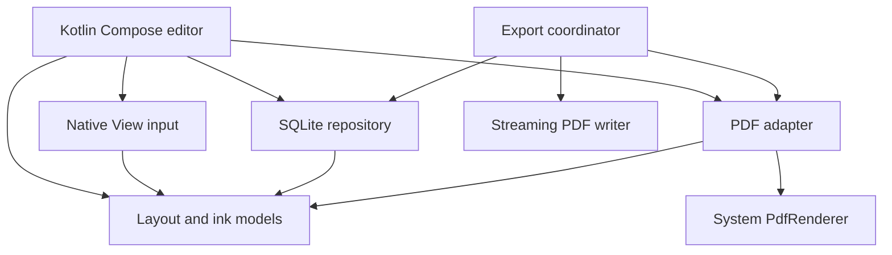

# OpenNote / S0 architecture

Authority: docs/REQUIREMENTS.txt is the verbatim text extracted from the supplied v1.0 engineering document. Acceptance is cumulative S0–S5, not a claim that all requirements are implemented.

Android 13+; Kotlin/Compose editor shell; Android native View for input and Canvas rendering; Java interoperable, Android-independent layout / ink / streaming export algorithms. No WebView, INTERNET permission, telemetry, cloud dependency or remote fonts.

Dependency graph: Compose app → editor controller → PageLayout / Ink domain models; app → SQLite WAL repository; PDF adapter → Android PdfRenderer; export → tiled composition + streaming RasterPdf writer. Code lives in one app module initially, organized by these responsibilities; avoid empty modules. Extract modules once the vertical slice stabilizes.

Immutable original.pdf is copied with a bounded buffer into a UUID document directory. Mutable data lives in SQLite transactions: document metadata, page dimensions/layout, compact per-stroke binary records, text cards. Atomic transactions commit at stroke completion, not at each sample. A save failure is visible. The import staging directory is only promoted after validation. Rendering caches are disposable and never authoritative.

Coordinates: source PDF points; expanded-page points; screen pixels; export points. Source slices map through explicit piecewise translation; View adds a uniform scale and pan matrix. 1 mm = 72/25.4 points. Blank insertion shifts existing ink below the cut; crossing strokes split with an interpolated boundary point. Blank removal must ask how to handle content in the blank. Layout source is never overwritten.

Render worker serializes PDF work. Only current page bitmap is retained; pixel budget bounds the full-page fallback. Foreground in-progress ink is separate from the cached background composition. This first slice is NOT the S5 tile/LRU pipeline. Export renders bounded-height strips and streams JPEG XObjects into a PDF, avoiding whole-document raster accumulation; exported PDF text is rasterized and explicitly labeled.

Limits requiring future stages: continuous virtual scrolling, full tile cache, command deltas for large histories, partial erasing/lasso, full ZIP64 library schema, native parser isolation/timeouts. Current-page rendering and PDFium internals still require real file-size/ABI testing before any GB claim.

The coordinator is currently MainActivity; extraction into a lifecycle-scoped controller is planned before long-running library/backup jobs. System rendering and storage are background tasks; in-progress native drawing does not publish per-point Compose state.
